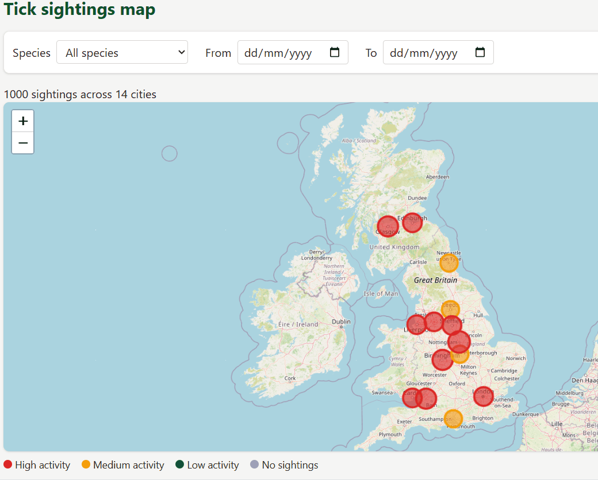
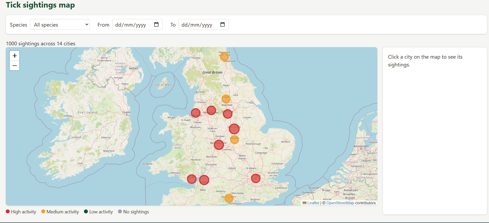
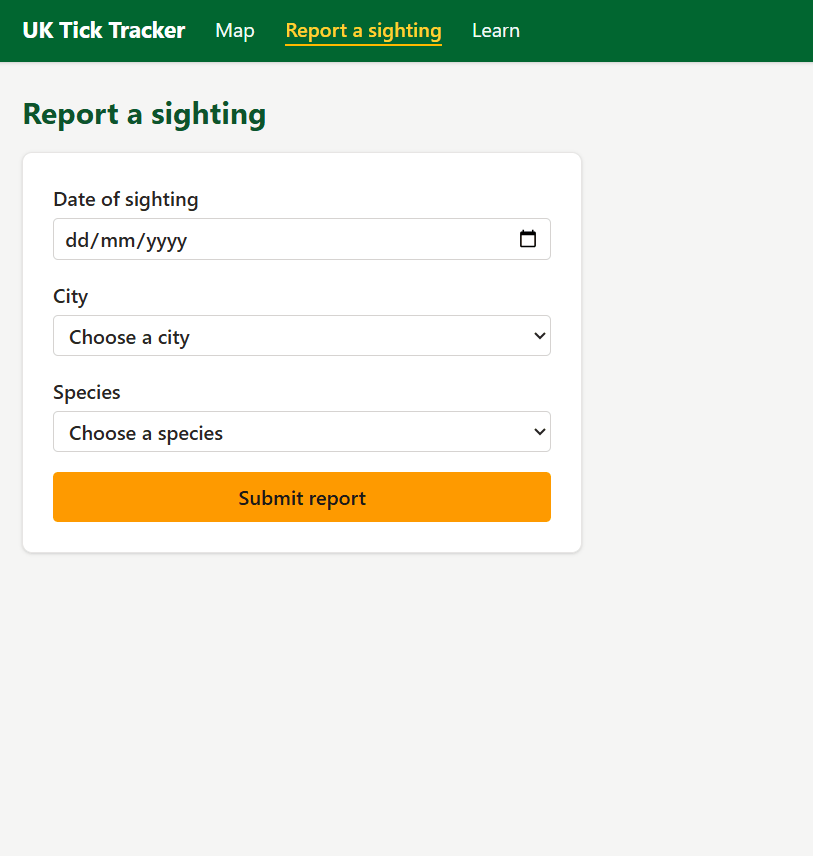
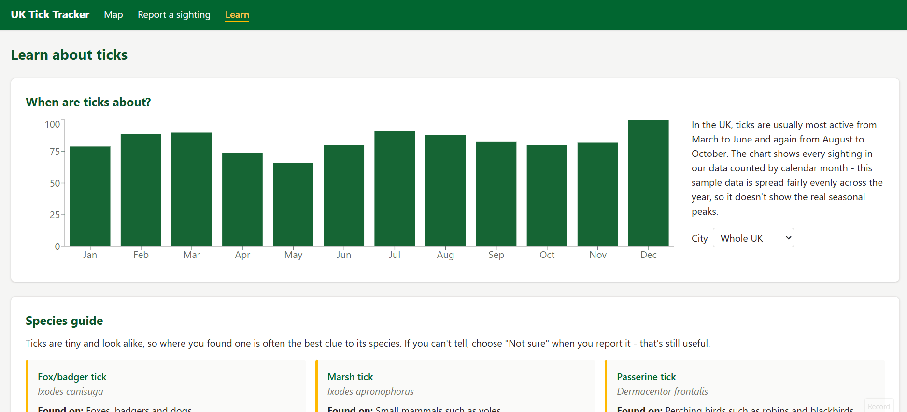

# Oliver Garvin Elanco Submission - Full Stack UK Tick Tracker

link to video walkthrough - https://youtu.be/sgA_bzXC-Ws

A web app for tracking tick sightings across the UK. See tick sightings on an interactive map, see how activity in each city has changed over time, report your own sighting, and learn how to identify ticks and avoid bites.

Built with React, Flask, Tailwind CSS, Leaflet, Recharts and SQLite, using sighting data from the Elanco tick sightings API.

## Features

- **Interactive sightings map** - Every city is a circle on a map of the UK. The size shows how many sightings it has, and the colour shows its activity level compared with the busiest city. Filter by species and date range, and the map updates straight away.

  

- **City details** - Click a city to open a sidebar with its total sightings, a chart of sightings per year, a breakdown by species and its five most recent sightings. The sidebar follows the map's filters.

  

- **Report a sighting** - A form for the date, city and species, with a "Not sure" option for people who can't identify their tick. Mistakes are shown under each field, warnings appear as you type (for example, a sighting over a year old), and a message confirms when the report is saved. New reports appear on the map straight away.

  

- **Learn about ticks** - A chart of sightings by month of the year for any city, a guide to the five species in the data, and tips on preventing bites for people and pets.

  

## Technical choices

### Handling the Elanco data

- **API failures** - Requests time out after 10 seconds and are retried 3 times on connection errors, rate limits and server errors. If Elanco is down, the app keeps running with the sightings it already has.
- **Incomplete data** - Records with missing fields, invalid or future dates, or unknown cities are skipped instead of crashing the import.
- **Duplicates** - Each Elanco id is stored in a unique column, so re-importing never creates copies.

### Backend

- **Flask with plain SQLAlchemy** - A small Flask app with one file of routes, and SQLAlchemy for the database.
- **Validating reports** - The server checks every new report: the date must be real and not in the future, and the city and species must be from the app's lists. Invalid reports get a `400` with a message, which the form shows under the matching input. The form also checks before sending, so users get instant feedback.
- **Tested** - tests cover the data import, validation, searching, stats and API error handling. They run against an in-memory database, and the Elanco API is replaced with fake responses, including failures.

### API endpoints

| Method | Endpoint | Options | Returns |
| --- | --- | --- | --- |
| GET | `/api/sightings` | `start`, `end`, `location`, `species` | Matching sightings, newest first |
| POST | `/api/sightings` | JSON body: `date`, `location`, `species` | The saved sighting (`201`), or an error for each invalid field (`400`) |
| GET | `/api/stats/regions` | `start`, `end`, `species` | Number of sightings per city |
| GET | `/api/stats/trends` | `interval` (`week`, `month` or `year`), `start`, `end`, `location`, `species` | Number of sightings per week, month or year |
| GET | `/api/stats/seasonal` | `location`, `species` | Number of sightings in each calendar month, January to December |
| GET | `/api/options` | - | The cities (with coordinates) and species, for the frontend's dropdowns and map |

### Frontend

- **React Router** - Real links between the three pages, so the back button and bookmarks work.
- **Leaflet** - Free, open source and needs no API key, so anyone can run the repo straight away.
- **Recharts** - Draws the API's `[{period, count}]` lists directly, with less setup than Chart.js.
- **Tailwind CSS** - Named classes built with `@apply` in [`index.css`](frontend/src/index.css), so the JSX stays readable.

## Accessibility

- **Labels and keyboard** - Every input has a visible label, and the navigation, filters, forms and buttons all work with Tab and Enter, with an amber outline showing what is selected.
- **Announced messages and contrast** - Errors use `role="alert"` and the "Report sent" message uses `role="status"`, so screen readers read them out. The amber buttons use dark text so they're easy to read.

## Running locally

Needs Python 3.10+ and Node.js 20.19+ (built with Python 3.14 and Node 24).

```bash
# terminal 1 - backend
cd backend
pip install -r requirements.txt
cp .env.example .env            # Windows: copy .env.example .env
python server.py

# terminal 2 - frontend
cd frontend && npm install && npm run dev
```
Then open http://localhost:5173 (the API runs at http://127.0.0.1:5000).
